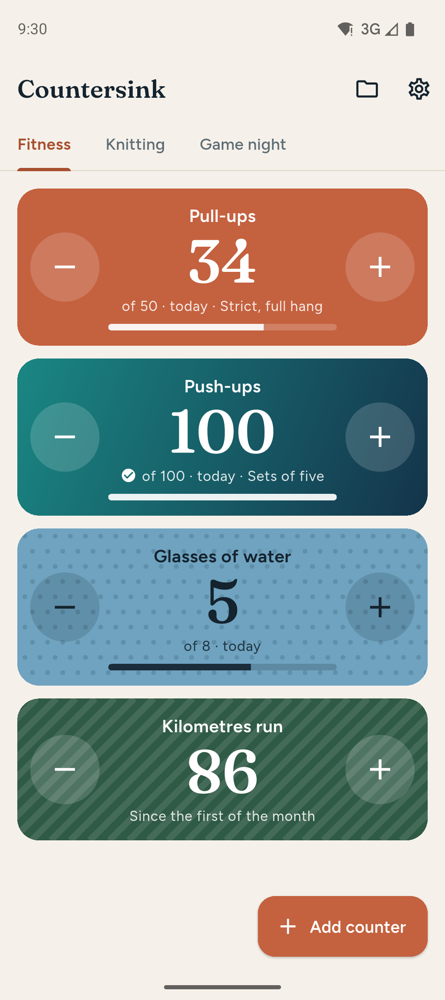
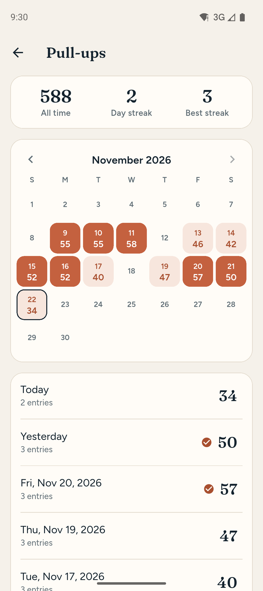
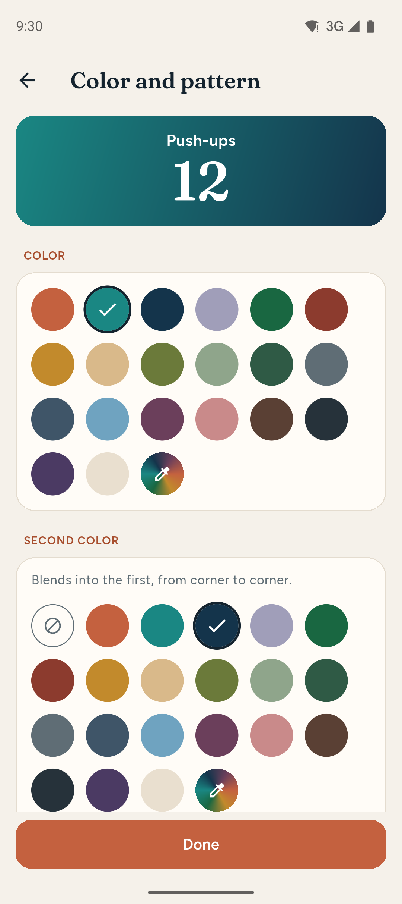
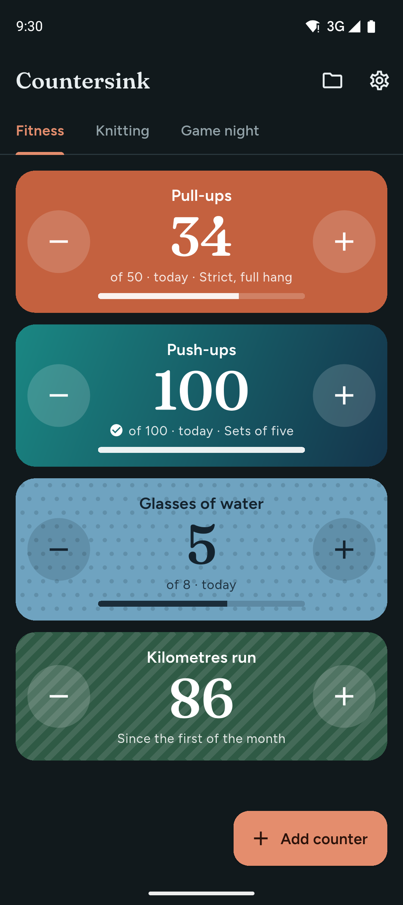

<div align="center">
  
  <h1>Countersink</h1>
  <p>Keep count of anything. No ads, and your counts stay on your phone.</p>
</div>

A tally counter for Android: pull-ups today, rows knitted, points scored,
boxes on a shelf. Counters live in groups, each group a tab, and each counter
is a large number with minus on one side and plus on the other.

<p align="center">
  
  
  
  
</p>
<p align="center"><sub>Screenshots use fictional data.</sub></p>

**Public beta.** Download the latest release from
[countersink.superdavelab.com](https://countersink.superdavelab.com/).

## Why Countersink exists

Counting things is a small job that deserves a good tool. Countersink is our
attempt at one: a high-quality counter offered as free and open source
software, for its own sake.

It will always be **free and open source**: no ads, no price, no premium
tier, no account.

## What it does

- **Counts without looking.** A plain tap only ever counts; everything else
  opens from press and hold, so a stray touch mid-count can't open a dialog.
  Plus and minus stay where they are, and a count never goes below zero.
  Full screen turns the whole screen into the button, and the volume buttons
  can count there too.
- **Keeps every count, with its time.** A counter stores no number: its
  value is the sum of its entries. That is what makes a day's total, a
  history, a chart and an undo exact, and lets you correct, delete or add an
  entry later.
- **Per-day counters** that start from zero each day and keep the days
  before, with the day starting at the hour you choose.
- **Goals and streaks**: a goal for each day, for the week, or a total to
  reach, with a month calendar and current and best streaks.
- **Calculated counters**: a total, a difference, a share in percent, or
  completed rounds (every 108 beads, every 8 rows), worked out from other
  counters on the spot.
- **Ready-made sets** to start from: rows and repeats, beads, in and out, a
  scoreboard, made and missed.
- **A home-screen widget** for any counter, and a **quick-settings tile**
  that adds to one you choose.
- **Your own look**: any colour for a counter, a second to blend into,
  patterns, light and dark themes.

## Privacy

Your counts are written to a database on your phone and nowhere else.
Release builds have no `INTERNET` permission, so Android itself prevents the
app from sending anything, and you can check that in the app's permission
list. The one permission Countersink asks for is the camera, and only if you
receive counters from another phone by scanning its QR codes. No analytics,
no ads, and excluded from Android's cloud backup. See
[docs/privacy.md](docs/privacy.md), and [SECURITY.md](SECURITY.md) for how to
report something that breaks this.

The trade-off, stated plainly: **there is no cloud copy, so a lost phone
means lost counts** unless you've saved a backup.

## Moving your counts

- **Back up to a file**: a plain, [documented](docs/backup-format.md) JSON
  file, saved wherever you choose. Or pick a folder and Countersink saves
  the day's backup there each time you leave it.
- **Phone to phone**: one phone shows a short series of QR codes and the
  other scans them, all your counters or the ones you choose. Nothing goes
  over a network.
- **Export as a spreadsheet**: a CSV with one row per entry.
- **Import** from BetterCounter, Counter and Simple Counter files.

## Languages

English, German, Spanish, French, Italian, Portuguese (Portugal) and Russian.
All but English are first drafts that no native speaker has checked yet;
corrections are welcome, and so is a language Countersink doesn't speak yet.
See [docs/translating.md](docs/translating.md).

## Supporting Countersink

Countersink costs nothing and always will, and nothing in the app will ever
ask you for money. If you'd like to chip in anyway, you can
[donate on Liberapay](https://liberapay.com/superdave/).

## Development

Requires Flutter (version pinned in `.github/workflows/ci.yml`) and the
Android SDK. Android only.

```bash
flutter pub get
flutter test
flutter analyze
flutter run
```

Releases are built from a tagged commit by `tool/build_release.sh`, which
refuses any build that asks for a permission other than the camera; see
[docs/RELEASING.md](docs/RELEASING.md). Plans:
[docs/roadmap.md](docs/roadmap.md).

## Licence

Copyright (C) 2026 SuperDaveLab

Countersink is free software: you can redistribute it and/or modify it under
the terms of the GNU General Public License as published by the Free Software
Foundation, either version 3 of the License, or (at your option) any later
version. It is distributed in the hope that it will be useful, but WITHOUT
ANY WARRANTY; without even the implied warranty of MERCHANTABILITY or
FITNESS FOR A PARTICULAR PURPOSE. See [LICENSE](LICENSE) for the full text.

The bundled fonts, Fraunces and Figtree, are under the SIL Open Font License;
their licence texts are in [assets/fonts](assets/fonts).

Part of [SuperDave Lab](https://superdavelab.com/).
